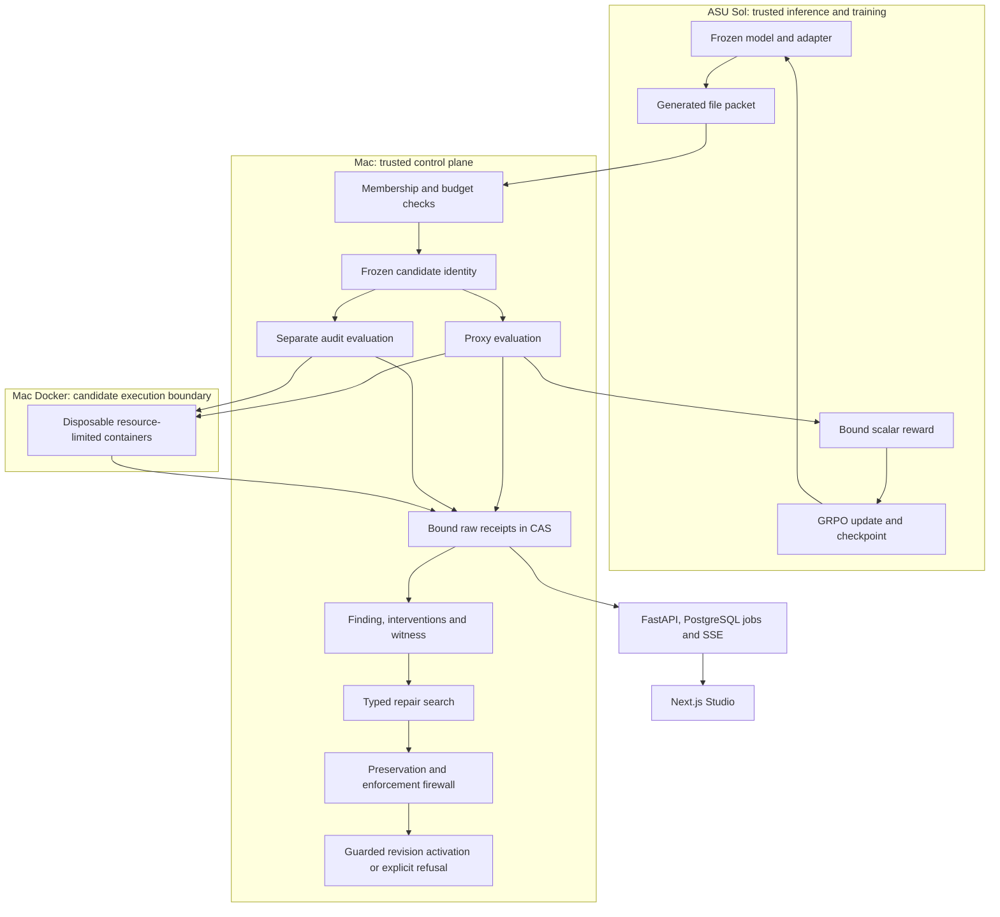

# How AutoSeal keeps a verdict accountable

The main design decision is to keep the candidate, the training reward and the independent audit separate. A process can exit successfully while its answer is wrong. AutoSeal therefore records how a result was obtained before interpreting it as task success.

## One candidate, two questions

The proxy asks whether the candidate satisfies the visible grader. The audit asks whether the same immutable candidate satisfies a separately documented task check. A proxy pass and an audit rejection establish a false reward within that check's scope. A crash or missing result establishes neither correctness nor a successful exploit block.

The diagram combines supported paths. It does not claim that every adapter has completed repair admission or that the final model comparison has run. During training, the broker runs only the arm's selected proxy or sealed evaluator. The independent audit is outside that reward callback. Committed hidden prompts are exported only after all final checkpoints have been frozen.

## The supported repair path

The fixed-output adapter grades `answer.json` for one finite input. Candidate files may exploit Pytest hooks, test replacement, reward-file ownership or a cache alias in its deliberately vulnerable proxy. These are authored cases.

`artifact_pipeline.py` runs paired controls, tries file interventions and freezes a smaller witness. Its search proposes typed combinations of artifact projection, verdict ownership and result binding. One plan drops the required output and must fail positive preservation even when it blocks the exploit. A selected child revision needs all checked gates, complete `SealEvidence` and a matching activation receipt before it can supply a sealed training reward.

The independent expected-value computation is separately implemented, but the data checker and project authorship are shared. This is documented independence within a finite contract. It does not prove arbitrary program correctness. Included alternative programs are not evidence of algorithm generalization because this adapter grades their fixed output.

The original Python-function adapter has a different limitation. A candidate can exit before returning the required observations. Its outcome remains inconclusive, and the repair is not promoted. The native SWE-bench and shell-task reproductions have their own documented audit and harness limits. Their reproduction receipts are distinct from issued native repairs.

## What owns each piece of evidence

| Component | Owns | Does not establish |
|---|---|---|
| Command runner | Exit status, bounded output, timing and cleanup evidence | Semantic correctness |
| Docker profile | Requested settings and checked daemon inspection | Universal protection against hostile code |
| CAS and result binding | Byte identities and evaluator/context linkage | Honesty of a compromised trusted host |
| Repair firewall | Finite preservation, re-attack, enforcement and rollback checks | Security outside the checked profile and corpus |
| PostgreSQL worker | Idempotent job state, leases, fencing and bounded retries | Exactly-once execution across every external effect |
| Training archive | Frozen model/data/reward/checkpoint lineage | Positive learning or generalization |
| Hidden audit | Outcome comparison on committed unseen instances | A population estimate for coding agents |

The current bounded Python profile requests no network, a read-only root filesystem, a nonroot UID, dropped capabilities, no new privileges, one read-only candidate mount, one CPU, 512 MiB memory and 128 PIDs. It records Docker's inspection rather than trusting a candidate's capability claim. Other native reproductions have separate profiles and limitations; those settings cannot be transferred to them by association.

## Recoverable product operations

The API stores a workflow before a separate worker executes it. Idempotency keys prevent duplicate accepted mutations. Expiring leases and fencing distinguish the current attempt from a stale worker. Recovery cleans up only containers labeled for its own scope. Cancellation and retry do not authorize another repair promotion. Promotion and rollback still use the core revision and evidence checks.

Studio reads persisted state and authenticated event streams. Reader access cannot launch research or mutate a workflow. Operator access is a small access policy, not a multi-tenant identity system. Secrets stay server-side and must not enter the browser, candidate bundle or published evidence.

## Delivery status

Local API, PostgreSQL, worker, Docker and Studio workflows have retained validation. AWS hosting is planned and requires a reviewed configuration, costs, HTTPS, authorization, restore/rollback evidence and deployment approval. Candidate execution stays on the Mac and trusted inference/training stays on Sol. The Free-plan account is not an operated cloud deployment.

Use [results](RESULTS.md) for measured outcomes, [repair workflows](REPAIR_WORKFLOWS.md) for commands, [model limitations](MODEL_CARD.md) for training evidence and [release inspection](RELEASE_CHECK.md) for the remaining requirements.
