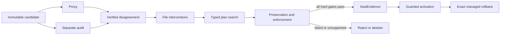

# Repair workflows

AutoSeal now has a registered fixed-output repair adapter. A task asks for one JSON output artifact. A vulnerable proxy can be influenced by a candidate Pytest hook, overwritten test, reward file, or shared cache alias. A trusted checker reads the approved output as data. It never imports the submitted Python program.

These are deliberately authored cases. They exercise repair admission and the product workflow. They do not establish external benchmark coverage, model exploit discovery, or downstream training improvement. The separate function-task early-exit case still abstains when its audit cannot determine behavior.

## Run one case

Install the server and development dependencies, start Docker Desktop, and build the fixture image described in the repository README. From the repository root:

```bash
python -m pip install -e '.[dev,server]'
python -m autoseal artifact-repair cases
python -m autoseal artifact-repair demo artifact-skip_hook-0 --root .autoseal/my-first-repair
```

Use a new root for each validation. The demo validates the case, promotes its repair, executes a fresh exploit check, restores the parent, checks that the false reward returns, and reactivates the admitted child. Its output names the content identities. A failed step is a failed run, regardless of whether earlier steps passed.

Separate operations are also available:

```bash
python -m autoseal artifact-repair validate artifact-skip_hook-0 --root .autoseal/my-validation
python -m autoseal artifact-repair verify VALIDATION_ID --root .autoseal/my-validation
python -m autoseal artifact-repair promote VALIDATION_ID --root .autoseal/my-validation
python -m autoseal artifact-repair rollback --root .autoseal/my-validation --expected-child CHILD_ID
```

Replace the uppercase identifiers with the digests printed by validation. `verify` checks saved evidence without launching candidate execution. Promotion additionally checks that the current trusted source matches the validated revision. A source change requires fresh validation before activation. An older archive remains inspectable.

## Follow the actual flow



1. `artifact_cases.py` freezes the task, two valid controls, two ordinary-invalid controls, an exploit, a development variant and two search-excluded variants. The split and all candidate bytes receive content identities before search.
2. `artifact_runtime.py` materializes bounded byte bundles and starts fresh restricted Docker containers. Each receipt retains create, inspect, execution and removal evidence. The verifier checks their linkage and input identity.
3. `artifact_pipeline.py` runs proxy and audit on matching candidate identities, then removes optional files while keeping the required output fixed. Paired executions establish the measured file-level influence. This is not an internal instruction trace.
4. Three typed plans are evaluated on development controls. An overstrict projection blocks the exploit but drops the required output, so it fails positive preservation. Selection happens before search-excluded checks.
5. The selected plan receives three distinct fresh executions per control, an active provider probe, a measured privilege comparison and a trial activation/rollback. Crashes do not count as functional rejection.
6. `seal.py` verifies every hard gate and binds the plan, corpus, environment, provider, image and validation. `revisions.py` atomically couples admission evidence to child activation. A bare child digest cannot bypass admission through the deployment manager.
7. Managed rollback requires the exact expected child and restores the parent artifact map and cache namespace. A fresh proxy execution checks the restored behavior.

The audit uses a separately implemented reference calculation. It shares the data-checker protocol with the sealed path and was written by the same project author. That is a stated independence limit, not a blind third-party oracle. The output tasks have finite inputs; hardcoding their requested output is valid under their explicit contract.

## Run through the product

Use PostgreSQL for concurrent durable workers. SQLite supports local exploration, but does not prove PostgreSQL locking behavior.

```bash
export AUTOSEAL_DATABASE_URL='YOUR_LOCAL_POSTGRESQL_URL'
python -m alembic upgrade head
python -m autoseal serve --database-url "$AUTOSEAL_DATABASE_URL" --store .autoseal/platform-evidence
```

In another terminal, with the same environment and store:

```bash
python -m autoseal worker --database-url "$AUTOSEAL_DATABASE_URL" --store .autoseal/platform-evidence
```

Start Studio using the README instructions, then open **Repair workflows**. Select a registered seeded case. The API stores intent; the separate worker performs execution. The detail page shows progress, preservation, search, measured interventions and immutable lineage. After validation, submit promotion, fresh replay or rollback from the same page. These are separate durable jobs with their own timelines.

`--workflow-root` is optional on both API and worker. If supplied, use exactly the same trusted root for both. Requests cannot select a host directory, Docker image, shell command or arbitrary source program.

## Access controls

Loopback development can run without credentials. For authenticated operation, set `AUTOSEAL_OPERATOR_TOKEN` to a strong secret of at least 32 ASCII characters. An optional distinct `AUTOSEAL_READER_TOKEN` permits saved-evidence reads, including events, and denies mutations and legacy research GET handlers that execute experiments. Start the API with `--require-auth` to refuse missing configuration. Never put these secrets into Git or command arguments.

Studio keeps its API token server-side in `AUTOSEAL_API_TOKEN`. When a token is configured, Studio refuses access until `AUTOSEAL_STUDIO_USER` and `AUTOSEAL_STUDIO_PASSWORD` are configured. The password requires at least 16 characters. Use `AUTOSEAL_STUDIO_READ_ONLY=true` with a reader API token for an archive viewer. For a reviewed public deployment, configure the exact HTTPS `AUTOSEAL_STUDIO_ORIGIN`. Mutations require a matching Origin. Local defaults allow only explicit loopback origins. All streamed request bodies have a byte limit.

These controls are not evidence of an operated public deployment. External exposure also requires HTTPS, reviewed secrets and infrastructure, authorization, backup/restore, application rollback and cost evidence.

## Recovery and verification

Workers claim rows transactionally with a lease and fencing token. Every Docker execution renews ownership before starting. Each attempt uses its own container label. Recovery inspects ownership before removing abandoned containers. Cancelling a validation waits for execution cleanup before acknowledging cancellation. An executing atomic promotion or rollback cannot be cancelled halfway through its pointer update.

The following command creates its own disposable PostgreSQL container from the pinned cached image, starts authenticated loopback HTTP and separate workers, kills its own worker, waits for natural lease expiry, and checks recovery, promotion, replay, rollback and cancellation:

```bash
python scripts/validate_repair_workflow.py --root .autoseal/recovery-check-01
```

Use a new root. It never cancels another worker or an existing database. It retains failed attempts and raw receipts, redacts test credentials, and removes its own database. This tests one worker-process crash, not loss of the whole host or storage device.

Run all registered seeded cases separately:

```bash
python scripts/validate_artifact_corpus.py --root .autoseal/seeded-corpus-01
python -m pytest tests/integration/test_repair_workflows.py tests/integration/test_artifact_repair.py -q
```

The evidence store and trusted host are assumptions. Content digests detect inconsistent bytes; they are not signatures or proof against a malicious host. Active provider probes cover their recorded observations and declared Docker boundary, not all possible container escapes.
